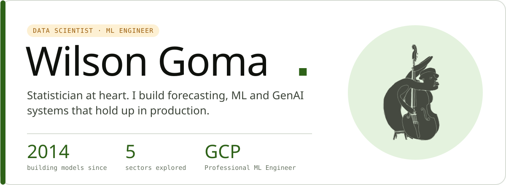
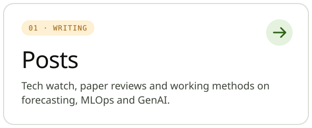
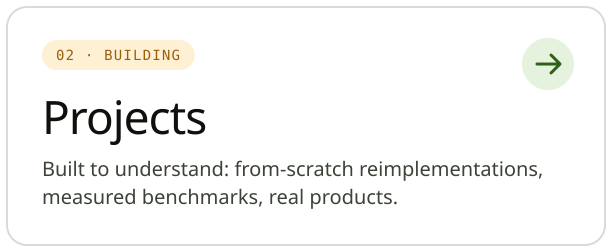
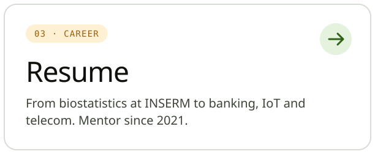
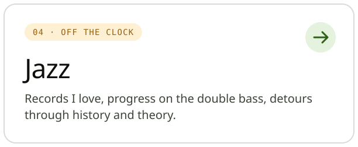
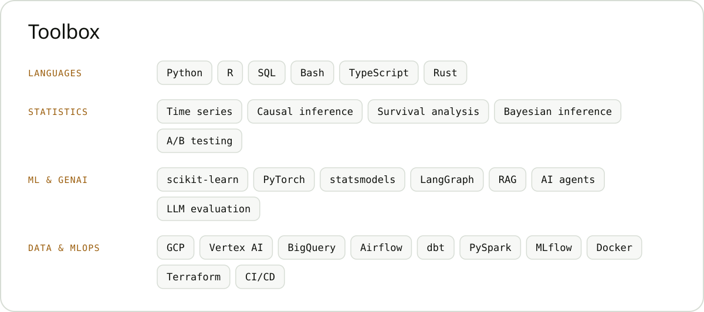

<a href="https://gwils28.github.io/en/">
  <picture>
    <source media="(prefers-color-scheme: dark)" srcset="assets/header-dark.svg">
    
  </picture>
</a>

  
  
  

I'm a data scientist with a strong taste for statistics, specialised in **time series** and **causal inference**, with hands-on experience in **LLMs and AI agents**. I started in biostatistics at INSERM, then moved through banking, IoT and telecom, always with the same goal: models that help people understand how things work and make better decisions. Since 2021 I also mentor Data Science, Data Engineering and AI Engineering learners at OpenClassrooms.

My website is where I think out loud: tech watch, paper reviews, and projects I build to understand things by doing them.

  <a href="https://gwils28.github.io/en/posts/"><picture><source media="(prefers-color-scheme: dark)" srcset="assets/card-posts-dark.svg"></picture></a>
  <a href="https://gwils28.github.io/en/projects/"><picture><source media="(prefers-color-scheme: dark)" srcset="assets/card-projects-dark.svg"></picture></a>
  <a href="https://gwils28.github.io/en/cv/"><picture><source media="(prefers-color-scheme: dark)" srcset="assets/card-resume-dark.svg"></picture></a>
  <a href="https://gwils28.github.io/en/jazz/"><picture><source media="(prefers-color-scheme: dark)" srcset="assets/card-jazz-dark.svg"></picture></a>

<picture>
  <source media="(prefers-color-scheme: dark)" srcset="assets/stack-dark.svg">
  
</picture>

  <i>"All models are wrong, but some are useful."</i> · George E. P. Box 
  🎩 I have a statistics joke, but I'm afraid it will only appeal to a small sample.

